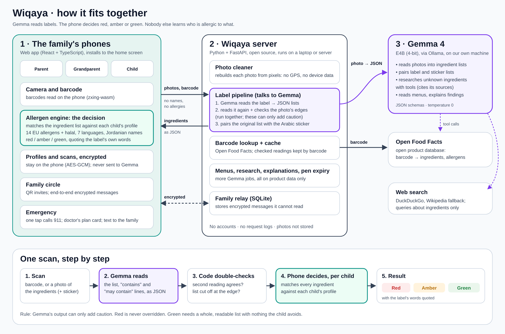

# How Wiqaya works

A plain explanation of the system, the stack, how a result is decided and how Gemma 4 is used. Written so anyone on
the team can answer a judge's technical question.

## The idea in one paragraph

Wiqaya has three parts. The **family's phones** run a web app that keeps every allergy profile and makes every
decision. A small **Wiqaya server** receives label photos and barcodes (never names or allergies), asks **Gemma 4**
to turn the photo into a clean ingredient list, double-checks that reading, and sends the list back. The phone then
compares the list with each child's profile and shows red, amber or green, quoting the label's own words.

**Gemma reads; code decides.** Gemma never says whether a food is safe for a child. It only turns pictures into
structured text. A fixed, tested engine on the phone makes the call.

## The three parts

### 1. The family's phones (web app)

- **What it is:** a web app (React 19 + TypeScript, built with Vite) that installs to the home screen like an app.
  It works on any phone with a browser, so families don't need an app store.
- **Camera and barcode:** the camera runs in the browser. Barcodes are read on the phone itself (zxing-wasm).
  Photos are resized on the phone before they are sent.
- **Allergen engine (the decision):** TypeScript code in `web/src/engine`. It knows the 14 major allergens of the
  EU list plus halal and vegetarian, in seven languages, and a Jordanian pack of local names (jameed, kishk,
  freekeh, labneh, turmus). It matches every ingredient against each child's profile.
- **Storage:** profiles, scans and the doctor's emergency plan are stored on the phone, encrypted (AES-GCM).
- **Family circle:** a parent invites a grandparent or a child by QR code. Messages between phones (a grandmother
  asking "can Omar have this?", the parent's answer) are end-to-end encrypted. Changes to profiles are signed by a
  parent (ECDSA), so only a parent can change them.
- **Emergency:** one tap calls 911, a card for paramedics in Arabic and English shows the doctor's plan, and a text
  to the family is written on the phone and sent by its own messaging app.

### 2. The Wiqaya server

- **What it is:** Python + FastAPI, open source, one command to run (`uv run wiqaya serve`). It can run on a laptop
  at the event or on any server.
- **Photo cleaner:** every photo is rebuilt from its pixels only, so GPS and device data are dropped. Photos are
  not stored.
- **Label pipeline:** sends the photo to Gemma, checks the answer (below) and returns the ingredient lists.
- **Barcode lookup:** Open Food Facts, a free open database of food products. Readings that passed every check are
  cached by barcode, so the next scan of the same product is instant.
- **Other Gemma jobs:** restaurant menus, researching unknown ingredients, plain-language explanations, reading the
  expiry date off an epinephrine pen's box.
- **Family relay:** a small SQLite store that passes the family's encrypted messages between phones. It cannot read
  them.
- No accounts, no request logs.

### 3. Gemma 4

- **Model:** Gemma 4 E4B (instruction-tuned, 4-bit quantized, `gemma4:e4b-it-qat`), run locally with **Ollama**.
  It is small enough for a laptop, sees images, and reads many languages, including Arabic.
- **Why Gemma 4:** open weights (we run it ourselves, so photos never go to a third-party AI service), vision and
  multilingual in one small model, and tool use for research.
- **How we call it:** every call asks for JSON that must match a schema (so the answer is always structured), at
  temperature 0 (the same photo gives the same answer), with "thinking" turned off for speed.

## One scan, step by step

1. **Scan.** The phone reads a barcode, or photographs the ingredients (and the Arabic sticker, if there is one).
2. **Gemma reads.** The server cleans the photo and asks Gemma for the ingredient list, the "contains" line and the
   "may contain" line, as JSON, and whether the list looks complete and legible.
3. **Code double-checks Gemma.** Two checks run at the same time:
   - **Second reading:** Gemma reads a slightly cropped copy of the photo. If the two readings don't mostly agree,
     the list is marked "not legible". This catches lists Gemma invents for a photo that shows none.
   - **Edge check:** Gemma copies the printed lines exactly; code checks whether a line ends in a word cut off by
     the photo's edge. If so, the list is marked "not complete".
   - If there is an Arabic sticker, Gemma pairs each item of the original list with the sticker's item, and code
     finds anything the sticker leaves out.
4. **The phone decides, per child.** The engine matches each ingredient (and its English translation) against the
   child's allergies.
5. **Result.** One card per child, with the allergens that caused it and the label's words quoted.

## How a result is decided

| Result | When |
|---|---|
| **Red: not suitable** | An allergen the child avoids is in the ingredients or the "contains" line; or the Arabic sticker leaves out an allergen the original names; or "may contain" for a child set to avoid traces. |
| **Amber: check first** | "May contain" for a child who accepts traces; a "likely" ingredient (for example lecithin, often soy); the list is cut off or unreadable; no ingredient list at all; Gemma's research suspects an unknown ingredient; the sticker couldn't be compared. |
| **Green: no problem found** | The whole list was read and nothing on it is avoided. |

Safety rules built into the code:

- **Gemma can only add caution.** Its checks can lower "complete" or "legible", never raise them; its research can
  add amber, never remove a warning.
- **Red can never be overridden**, not even by a parent's approval. A parent can approve an amber product for one
  child; that approval is tied to the exact recipe and stops counting if the ingredients change.
- An ingredient Wiqaya doesn't recognise is noted on the result, and Gemma looks it up.
- Every result carries a reminder to double-check the label and ask the shop or the chef.

## Gemma's jobs

| Job | Gemma gets | Gemma returns |
|---|---|---|
| Read a label | a label photo | ingredient lists per language, "contains" and "may contain" lines, complete? legible? |
| Edge check | the same photo | the printed lines, copied exactly (code checks them) |
| Pair label and sticker | the two ingredient lists | which item matches which |
| Research unknowns (tool use) | names of unknown ingredients | possible allergens, with the sources it read (web search, Open Food Facts) |
| Explain | the product's findings | one plain sentence each |
| Read a menu | photos of a restaurant menu | each dish and what it is usually made with |
| Pen expiry | a photo of the medicine box | the printed expiry date |

Gemma never receives a name, an allergy profile or anything about the family. For explanations it gets every
finding on the product, not just the family's, so even that request doesn't reveal which allergy a family has.

## The stack

| Layer | Technology |
|---|---|
| Phone app | React 19, TypeScript, Vite; installable web app with an offline shell (service worker) |
| Barcodes | zxing-wasm, on the phone |
| Encryption | Web Crypto: AES-GCM for data, ECDSA signatures for parent changes |
| Server | Python 3, FastAPI, Uvicorn, httpx, Pillow (photo cleaning), pypdfium2 |
| AI | Gemma 4 E4B (4-bit) on Ollama, JSON-schema outputs, tool calling |
| Product data | Open Food Facts (open database), cached on the server |
| Research tools | DuckDuckGo web search with Wikipedia as a fallback |
| Family relay | SQLite |
| Tests | pytest (server), Node's test runner (engine), Playwright (two-phone walkthrough), a 30-label benchmark |

## Key decisions, and why

- **Code decides, not the AI.** A language model can be confidently wrong. A safety decision should be predictable
  and testable, so the AI does the reading and tested code does the deciding.
- **Profiles stay on the phone.** Allergy data is health data about children. Keeping it on the phone, encrypted,
  means a server leak can't expose it.
- **Run Gemma ourselves.** Photos of what a family eats don't go to a third-party AI company, and the system keeps
  working without a paid API.
- **Doubt makes a result amber, never green.** A false "safe" is far worse than an extra "check first".
- **A web app, not a native app.** One codebase for every phone, nothing to install from a store, easy to share by
  QR code at a school or a supermarket.
- **The Arabic sticker check.** Imported food in Jordan often has an Arabic sticker over a foreign label, and a
  sticker can drop a "may contain" line. Comparing the two is something only a multilingual model can do well.

## How we know it works

- **Benchmark:** 30 synthetic imported-food labels in six languages with exact answers, including stickers that
  drop a line and blurred or cut-off photos. Result: 0 false greens, 78 of 78 allergens flagged. Details in
  [RESULTS.md](RESULTS.md).
- **Real photos:** 24 photos of snacks taken in a shop, used to find and fix real-world failures (invented lists,
  cut-off lists, big multi-language panels).
- **Tests:** server and engine unit tests, and a walkthrough that drives two phones through the whole app (set up,
  scan, invite, ask, approve, emergency, Arabic).

## Questions judges may ask

**What if Gemma reads the label wrong?**
It is checked: a second reading must agree, and an edge check catches cut-off lists. If either fails, the result is
amber, not green. Gemma can never turn a warning into a green.

**Does the AI know my child's allergies?**
No. Gemma only sees label photos and ingredient names. Profiles are encrypted on the phone and the comparison
happens there.

**Why not just use the barcode database?**
Many products in Jordan aren't in it, or only have the Arabic sticker's text. The photo is the source of truth; the
barcode only fills in what the photo doesn't show.

**How fast is it?**
A barcode found in the database is instant. A label photo takes a few seconds on a laptop GPU. The second reading
and the edge check run at the same time to save time.

**Does it work offline?**
The app opens offline and shows saved results, profiles and the emergency card. Reading a new label needs the
Wiqaya server, which can run on a laptop on the same Wi-Fi.

**Is it medical advice?**
No. Wiqaya checks labels and says so on every result. It never decides whether a reaction is happening; the
emergency button calls 911.

**Can it scale?**
The server is stateless apart from a cache and the encrypted relay. It can run per school or per city, or on a
GPU server. Each family's data lives on its own phones.
